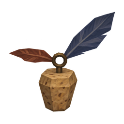

# WoW Fishing Forever



**River Desk** automates fishing in World of Warcraft: Forever on Windows. It finds the gold gear icon above the bobber, listens for the splash, and uses your Interact binding to reel in the catch.

[Download the stable release v1.2.0](https://github.com/Tmthetom/wow-fishing-forever/releases/tag/v1.2.0) · [Recover an earlier release](STABLE.md)

## Features

- **Fishing dashboard:** See session totals, start and stop times, average catches per hour, and time since the last catch. The daily chart shows the last 14 days, with exact counts on hover.
- **Bobber and bite detection:** Calibrate the gear icon for your display. The app uses the saved size first and can remeasure it if needed.
- **Optional lure and session controls:** Apply Bright Baubles on a timer, set a stop time, or enable periodic focus checks and jumps.
- **Diagnostics:** Copy timestamped logs and inspect the last matched frame and the audio score for each reference splash.

## Install on Windows x64

1. Download and extract the **Source code (zip)** from the stable release, or clone this repository. The source archive requires the setup below. A portable extract-and-run ZIP is planned.
2. Open PowerShell in the project folder. Use `uv` if it is on your PATH. Otherwise, download `uv-x86_64-pc-windows-msvc.zip` from the [Astral uv releases](https://github.com/astral-sh/uv/releases/latest) and extract `uv.exe` into `.local/uv`.
3. Install the locked dependencies and launch River Desk. The commands below use the downloaded `uv.exe`. Replace `.\.local\uv\uv.exe` with `uv` if it is on your PATH.

   ```powershell
   $env:UV_CACHE_DIR = Join-Path $PWD '.local\cache'
   $env:UV_PYTHON_INSTALL_DIR = Join-Path $PWD '.local\python'
   $env:UV_NO_REGISTRY = '1'
   .\.local\uv\uv.exe sync --locked --python 3.13 --managed-python --no-dev
   .\RiverDesk.cmd
   ```

Use `RiverDesk.cmd` for subsequent launches or create a shortcut to it with the [River Desk icon](src/wowfish/assets/river-desk.ico). The launcher gives the window and its temporary executable a new name on each launch, so point your shortcut at the launcher.

## Set the keys once

Put **Fishing** on a WoW action bar and bind **Interact With Target** in the game's settings. Enter the matching keys in **Setup → Key bindings** and click **Save keys**. River Desk uses US-style names for physical keys. The example below shows how the same keys are labeled on a Czech layout.

| Action | WoW key on a Czech layout | River Desk setting |
| --- | --- | --- |
| Fishing | `ú` | **Cast key** `[` |
| Interact With Target | `)` | **Interact key** `]` |
| Lure macro (optional) | Physical key matching `'` | **Lure key** `'` |

The [example configuration](config/forever-working.toml) contains these bindings and a working set of detection values. To use it, close River Desk, back up your existing configuration if present, then copy the example to `.local/state/config/config.toml`. Calibrate on your own display before fishing.

## Start a fishing session

1. Enable **Interact Key** and **Auto Loot** in WoW. Keep master sound and **Sound Effects** on. Turn **Music** and **Ambience** down to zero so splashes are easier to detect.
2. Enable the interaction icons by entering each command separately in WoW chat. To check a value beforehand, use `/dump GetCVar("SoftTargetIconInteract")` or `/dump GetCVar("SoftTargetIconGameObject")`.

   ```text
   /console SoftTargetIconInteract 1
   /console SoftTargetIconGameObject 1
   ```

3. Move River Desk to the side so it leaves the water and the bobber unobstructed. In **Setup → Calibration**, click **Calibrate the gear icon**, return to WoW, and cast manually. Click **Save calibration** once the gear icon is detected. Repeat this before each session.
4. Catch a few fish manually in WoW, even if you use a lure. If the gold icon never appears, try casting closer and recheck the interaction settings.
5. Select **Fishing → Start**, minimize River Desk, and keep WoW in the foreground.

When you finish, click **Stop**. Restore the sound, interaction, and loot settings you changed. To restore an interaction icon setting that was previously disabled, re-enter its command with `0`. Keep your fishing key bindings for next time.

## Optional settings

### Bright Baubles

Create a WoW macro, place it on an action bar, and bind it to the key selected as **Lure key** in River Desk.

```text
#showtooltip Bright Baubles
/use Bright Baubles
/use 16
```

Keep Bright Baubles in your bags and equip the fishing pole in the main-hand slot (`16`). The schedule allows six seconds for application (`run.lure_cast_s`) and renews after ten minutes (`game.lure_minutes`). The app cannot verify the active buff. Stop and Start preserve the schedule while the app stays open, including during the application wait. Changing the lure key, interval, or game window resets it. Reopen the app to reset it after changing characters or poles, or if the macro fails. Clear **Lure key** to disable the macro.

### Session controls

In **Setup → Session helpers (optional)**, set **Check foreground (min)** or **Jump every (min)**, then click **Save timers**. Empty fields and zero disable the timers. Changes take effect on the next Start.

- **Foreground check (Windows):** Ask Windows to return focus to WoW at the selected interval and begin a fresh cast after recovery. Windows may refuse the request. Stop River Desk before deliberately using another app if this option is on.
- **Scheduled jump:** Jump in place between casts using Space by default. A jump waits until the current cast has ended.
- **Stop after (min):** Set a session limit and click **Save limit**. Set it to zero to keep fishing until you click Stop. Set a **Quit key** only if you want the bot to send that binding when the time limit ends.

### Direct window capture (Windows)

In **Setup → Session helpers (optional)**, turn on **Capture the WoW window directly**. It reads the client area from the game window and can help when another window covers part of it. The setting is saved immediately and applies to the next calibration or Start. Standard screen capture is the default.

The game must stay open and unminimized. Fishing still pauses when WoW loses keyboard focus. To check compatibility, run a calibration with part of the game covered and see whether the preview still shows the underlying game image. If the preview is black, frozen, or reports an error, turn direct capture off and retry.

## Troubleshooting

| Symptom | What to check |
| --- | --- |
| The app does not open | Run `.\RiverDesk.cmd doctor` from PowerShell. A missing game window is expected while WoW is closed. Check `.local/state/log/launcher-error.log` for launcher errors. |
| No gear icon or repeated recasts | Confirm both interaction icon settings, clear the view of the water, and calibrate again. **Measured the gear icon** in **Activity → Logs** means the app measured a new size during a cast. |
| The app misses splashes | In **Setup → Audio diagnostics**, select the game's audio or a loopback device. **Record 60 s and check the bite** can suggest a threshold. Click **Save** to apply it. |
| Fishing shows **Paused** | Return to WoW. The bot requires keyboard focus, including when direct window capture is enabled. A logout that leaves the game window open has no dedicated detection. |

**Activity → Bite diagnostics** compares the captured sound with four reference clips. Blue, orange, and green are splash samples 1–3. Amber is the extra bite sample. Higher lines mean a closer match. The horizontal dashed line is the threshold, and a vertical marker labeled **bite** marks a detected splash. Manual starter catches do not train the detector.

## Local files

| Data | Path when launched with RiverDesk.cmd |
| --- | --- |
| Settings and saved calibration | `.local/state/config/config.toml` |
| Diagnostic log | `.local/state/log/wowfish.log` |
| Daily catch totals | `.local/state/log/catches.sqlite3` |

Session counters reset on each Start. **Catches / hour** appears after the first minute and **Since last catch** freezes when the session stops. Daily totals survive restarts and begin accumulating with the first GUI session that records a catch.

Based on [rsamf/wow-fishing-forever](https://github.com/rsamf/wow-fishing-forever). Released under the [MIT License](LICENSE).
